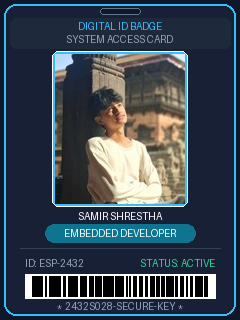

# ESP32-2432S028 (CYD) Digital ID Badge & Access Card 🪪⚡

A digital ID card sketch designed specifically for the **ESP32-2432S028** (commonly known as the *"Cheap Yellow Display"* / CYD).



---

## 🌟 Features

- **Embedded Photo**: Your photo from the reference image is professionally cropped and converted into a high-quality embedded JPEG stored directly inside the ESP32 flash memory (`photo_data.h`).
- **Cyber / Glassmorphic UI**: High-contrast, clean dark theme (`#0F172A`) with vibrant sky cyan neon borders, rounded pill badges, and realistic security barcode.
- **Interactive Touch Flipping**: Tap anywhere on the 2.8" resistive touch screen to flip the badge between the **FRONT** (Photo & Title) and **BACK** (Scannable QR Code & Credentials).
- **Live Scannable QR Code**: The back of the ID card features an authentic, real-time generated QR code powered by LovyanGFX. Point any smartphone camera at it to scan!
- **Onboard RGB LED Integration**: 
  - Front side active: Smooth emerald green glow (`Active Status`).
  - Back side active: Cyber cyan glow.
  - Screen tap: Instant tactile white flash pulse.
- **Zero Library Hassle**: Uses **LovyanGFX**, which configures all display & touch pins in the code directly without having to edit any `User_Setup.h` files!

---

## 📂 Project Structure

```
esp32 2432s028/
├── esp32_id_badge/
│   ├── esp32_id_badge.ino       # Main Arduino IDE sketch
│   ├── LGFX_ESP32_2432S028.h    # Hardware display & touch pin config
│   └── photo_data.h             # Embedded photo byte array (JPEG)
├── badge_preview.png            # Visual preview of the ID badge
├── id_photo_130x150.jpg         # Cropped photo
├── convert_photo.py             # Python script to update/convert future photos
└── README.md                    # This documentation
```

---

## 🚀 How to Open & Upload in Arduino IDE

### Step 1: Install LovyanGFX Library
1. Open **Arduino IDE**.
2. Go to **Sketch** -> **Include Library** -> **Manage Libraries...** (or press `Ctrl + Shift + I`).
3. Search for: `LovyanGFX` (by *lovyan03*).
4. Click **Install**.

### Step 2: Open the Sketch
1. In Arduino IDE, open:
   `esp32 2432s028/esp32_id_badge/esp32_id_badge.ino`
2. You will see tabs for `esp32_id_badge.ino`, `LGFX_ESP32_2432S028.h`, and `photo_data.h`.

### Step 3: Configure Board Settings
Under the **Tools** menu, select:
- **Board**: `ESP32 Dev Module` (or `ESP32 Arduino -> ESP32 Dev Module`)
- **Upload Speed**: `921600` (or `115200` if upload fails)
- **CPU Frequency**: `240MHz (WiFi/BT)`
- **Flash Frequency**: `80MHz`
- **Flash Mode**: `QIO`
- **Flash Size**: `4MB (32Mb)`
- **Partition Scheme**: `Default 4MB with spiffs (1.2MB APP/1.5MB SPIFFS)` or `Huge APP (3MB No OTA/1MB SPIFFS)`
- **Port**: Select the COM port where your ESP32 is plugged in.

### Step 4: Click Upload
Press the **Upload** button (`Ctrl + U`). If the upload doesn't start automatically, hold down the **BOOT** button on the back of the ESP32 until writing begins.

---

## ⚙️ Customizing Your Details

Open `esp32_id_badge.ino` and edit the lines at the top:

```cpp
// ================= USER PROFILE CUSTOMIZATION =================
const char* ID_NAME        = "SAMIR SHRESTHA";             // Your Full Name
const char* ID_POST        = "EMBEDDED DEVELOPER";         // Your Job Post / Role
const char* ID_NUMBER      = "ID: ESP-2432";               // ID / Employee Number
const char* ID_DEPARTMENT  = "IOT & EMBEDDED SYSTEMS";     // Department / Organization
const char* ID_STATUS      = "ACTIVE";                     // Card Status
const char* ID_BLOOD_GROUP = "O+";                         // Blood Group
const char* ID_EXPIRY      = "12 / 2028";                  // Validity / Expiry Date
const char* ID_CONTACT     = "+977 980-000-0000";          // Emergency / Contact Phone
const char* QR_LINK        = "https://github.com";         // URL for QR code
```

### Rotating the Screen
If your board is mounted upside-down (e.g., lanyard hole or USB port orientation), change:
```cpp
#define SCREEN_ROTATION    1   // Set to 1 (standard portrait: USB at bottom) or 3 (inverted portrait: USB at top)
```

---

## 📷 How to Update the Photo in the Future

If you want to use a different photo in the future:
1. Put your new photo in this folder (e.g. `my_photo.jpg`).
2. Run the included converter script in your terminal:
   ```bash
   python convert_photo.py my_photo.jpg
   ```
3. It will automatically crop and update `photo_data.h`. Re-upload your sketch to Arduino IDE!
